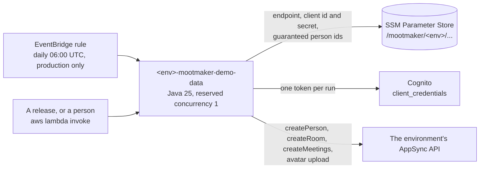

# mootmaker-demo-data

One Lambda per environment that keeps the environment populated with realistic people, rooms and
meetings. It is part of the product, not a test aid: it fills the public demo at www.mootmaker.com. What
a visitor sees, and why the data is shaped that way, is in the hub's
[demo data overview](https://github.com/geoffweatherall/mootmaker/blob/main/docs/overview/demo-data.md).
This page is the operating detail.

It is one of the three deployable components, with mootmaker-api and mootmaker-webapp.



## It never deletes anything

A run only adds. It creates the people, rooms and meetings that are missing and leaves everything else
alone, and there is no option that does otherwise. To start an environment from scratch, run
mootmaker-api's `database-reset` first and then this, as two deliberate commands.

## What a run does

Four concerns, each of which does nothing once its target is met:

| Concern | Target | Repeatable because |
|---|---|---|
| People | `TARGET_PEOPLE` (100) | It creates only the shortfall. Nine in ten get an avatar |
| Rooms | `TARGET_ROOMS` (10) | It creates only the shortfall, never reusing an existing room's name |
| Meetings | Every weekday from `DAYS_IN_PAST` (7) days back to `WEEKS_AHEAD` (6) weeks ahead | It skips any day that already has a meeting |
| Guaranteed meetings | The same weekdays, for each Person id in `/mootmaker/<env>/demo-data/guaranteed-person-ids` | It skips any day the person already organises or attends |

- **Guaranteed meetings** exist for the published demo account. Organisers and attendees are picked at
  random from about a hundred people, so without them the demo account's Calendar could be empty.
  mootmaker-api's Terraform writes the list. Each meeting goes in the first free room-and-hour slot
  among a few candidate hours, and a day with no free slot is skipped with a message. This concern runs
  after the meeting top-up, so a day the top-up has already covered for the person is left alone.
- **Seeding and topping up are the same operation.** In a new environment every day in the window is
  empty, so a run fills them all; in a running one it fills only the day that has just entered the
  window.
- **The people target counts everyone**, including real sign-ups: the API does not say which people
  have accounts. Where real sign-ups pass the target, no demo people are created.
- **Magnitudes are Terraform variables** (`deploy/terraform/variables.tf`), not payload fields. A
  mistyped invocation can switch a concern off but can never ask for 4,000 people.
- **The payload only toggles concerns**: `{"people": false}`, `{"rooms": false}`, `{"meetings": false}`.
  Each defaults to on; `meetings` covers guaranteed meetings too. The schedule sends `{}`.

## Avatars

- **Each generated person gets a photograph whose apparent sex matches their first name**
  (`SampleData.FEMALE_FIRST_NAMES`; every other name is treated as male). The pool is 100 men and
  100 women, 512×512 JPEGs in `impl/src/main/resources/avatars-photo/`. **None is a real person:** they
  were generated with Stable Diffusion 1.5 by
  [`photorealistic-avatar-generator/`](photorealistic-avatar-generator/), an authoring tool that needs a
  GPU and is not part of the build.
- **No two people in an environment share a photograph.** A run that would need more photographs of
  one sex than remain unused fails before creating anyone. Each half must therefore stay comfortably
  above half of `TARGET_PEOPLE`.
- **Which photographs are taken is read from the API, not remembered.** The API names each avatar by the
  SHA-256 of the uploaded bytes, and that hash is the last segment of `Person.avatarUrl`. `AvatarPool`
  hashes its own files, so a photograph is in use exactly when its hash appears in someone's URL.
- **Avatars are set exactly as the apps set them**: `requestAvatarUpload`, an HTTP `PUT` to the presigned
  URL, then `confirmAvatarUpload`. Every seeding run therefore exercises the upload path.

## Writes go through the API

There is no DynamoDB or S3 code here. Everything is created with the same mutations the apps use, so
generated data has passed the API's own validation and cannot be in a state the API would refuse.

The Lambda signs in as **its own Cognito machine client** (`<env>-mootmaker-demo-data`, defined in
mootmaker-api's `cognito.tf`) with the OAuth2 `client_credentials` flow. It reads the client id and
secret from SSM at run time, so no credential sits in an environment variable or in this repository's
Terraform state. It fetches **one token per run**, because Cognito charges for every machine-to-machine
token request.

## Running it

```bash
# Everything (what the schedule does)
aws lambda invoke --function-name <env>-mootmaker-demo-data \
  --cli-read-timeout 900 --payload '{}' /dev/stdout

# Only the meetings
aws lambda invoke --function-name <env>-mootmaker-demo-data \
  --cli-read-timeout 900 --payload '{"people": false, "rooms": false}' /dev/stdout

# Clear and repopulate: mootmaker-api's reset, then this
aws lambda invoke --function-name <env>-mootmaker-database-reset \
  --cli-read-timeout 900 --payload '{}' /dev/stdout
aws lambda invoke --function-name <env>-mootmaker-demo-data \
  --cli-read-timeout 900 --payload '{}' /dev/stdout
```

- **`--cli-read-timeout 900` is required.** The Lambda's timeout is the AWS maximum of 900 seconds, and
  the CLI gives up after 60 by default. A full seed then looks like a failure while the Lambda carries
  on and completes.
- **One run at a time.** The function reserves a concurrency of 1, so Lambda throttles an invocation
  that overlaps a running one. This is separate from `MAX_CONCURRENT_REQUESTS` in `DemoData.java`,
  which limits the parallel GraphQL calls one run makes.
- **The schedule** is an EventBridge rule at 06:00 UTC, enabled only in `production` unless
  `schedule_enabled` is set. A release also seeds `test` and `production` straight after deploying each,
  so a rebuilt environment never waits for the schedule.

## Build, test, deploy

```bash
mvn -f impl/pom.xml clean package          # build and unit tests (needs ../mootmaker-api for its schema)
mvn -f impl/pom.xml spotless:apply         # format
./deploy.sh <env>                          # build the jar and create or update the Lambda
./deploy.sh <env> --skip-build             # deploy impl/target/demo-data.jar as is (the release pipeline)
./verify.sh <env>                          # acceptance tests: reset, seed, check (refuses production)
./undeploy.sh <env>                        # remove it, after a prompt
./undeploy.sh <env> --yes                  # no prompt; refuses production and test
```

- **Deploy mootmaker-api to the environment first.** Its Terraform creates the SSM parameters this
  reads. Deployed without them, the Lambda comes up and then fails on its first invocation.
- **`deploy.sh` needs only the environment name.** It reads nothing from mootmaker-api's Terraform state.
- **`test` and `production` change only through a release** (`release.yml` in mootmaker-release), which
  calls this repository's `release-build.yml` to build the jar once and prove it in an ephemeral
  environment.

How it is tested: [testing-strategy.md](testing-strategy.md). If demo data is missing from an
environment, see the hub's
[demo data runbook](https://github.com/geoffweatherall/mootmaker/blob/main/docs/runbooks/demo-data-missing.md).
